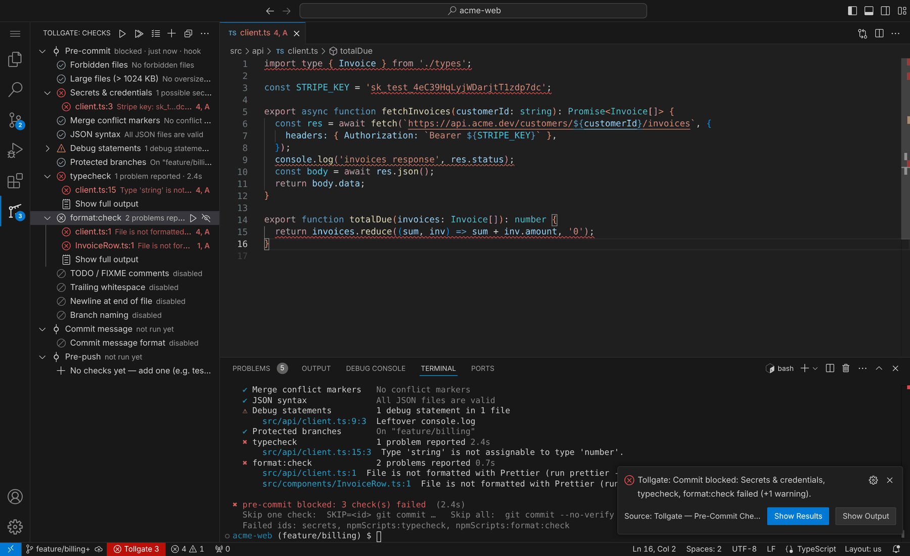
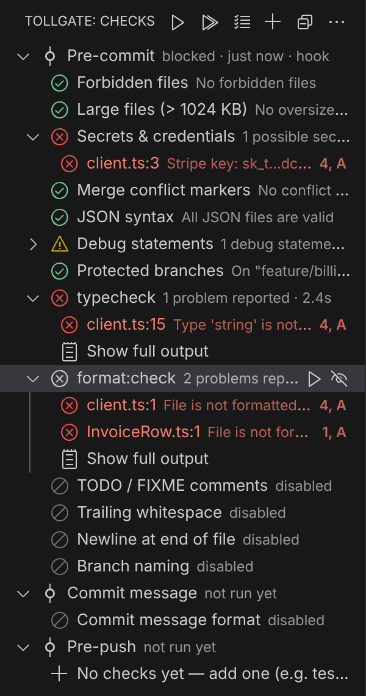
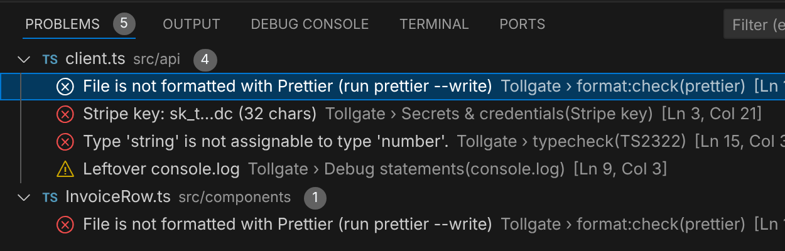
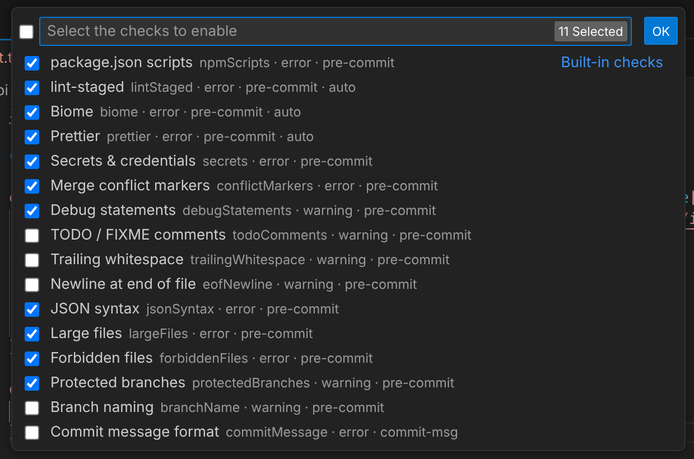
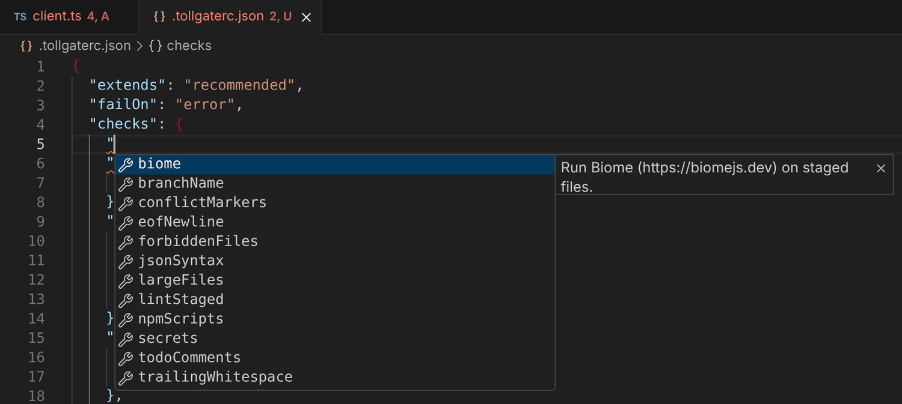

<p align="center">
  
</p>

<h1 align="center">Tollgate — Pre-Commit Checks</h1>

<p align="center">
  <b>Every commit stops at the gate.</b><br>
  Tollgate runs your linters, type-checker and formatter, and catches secrets, debug code, merge conflicts and oversized files <i>before</i> they reach your repository. It works whether you commit from VS Code or the terminal, and needs no setup.
</p>

---



## Why Tollgate?

- **Works on day one.** Open a repo and accept the prompt. Tollgate finds your `lint`, `typecheck` and `format:check` scripts, plus Biome, Prettier and lint-staged, and checks them on every commit.
- **Works in VS Code and the terminal.** It installs real git hooks, so commits from the Source Control panel, the terminal and other Git clients are all checked. Results always appear in VS Code.
- **Points at the problem.** Problems show up in a Checks view, the Problems panel and as squiggles in your code. Click any finding to jump to the exact line.
- **Only checks what you changed.** Content checks only look at the lines you added, so problems in old code never block your commit.
- **Configurable down to each check.** You can turn every check on or off, choose whether it blocks or warns, and tune it. You can also add any shell command as your own check.
- **Shared with your team.** Commit a `.tollgaterc.json` and everyone gets the same rules, with autocomplete and validation in the editor.

## Features

### What it checks

| Check | What it does | Default |
| --- | --- | --- |
| **package.json scripts** | Runs `lint`, `typecheck`, `tsc`, `format:check` and similar if they exist. Detects npm / yarn / pnpm / bun. Monorepo aware. | ✅ blocks |
| **Biome** | `biome check` on staged files when the project uses Biome | ✅ auto |
| **Prettier** | `prettier --check` on staged files when the project uses Prettier. Can format and re-stage for you. | ✅ auto |
| **lint-staged** | Runs your lint-staged config | ✅ auto |
| **.NET (C#)** | `dotnet format` on staged C#/VB files, `dotnet build`, CSharpier if you use it, and optionally `dotnet test` on push. See [C# and .NET](#c-and-net). | ✅ auto |
| **Secrets & credentials** | AWS, GitHub, GitLab, Stripe, Slack, Google, OpenAI, Anthropic, npm, Azure, SendGrid and Twilio keys, JWTs, private keys, passwords in code, in URLs and in connection strings. Matches are masked in the output. | ✅ blocks |
| **Merge conflict markers** | `<<<<<<<` / `=======` / `>>>>>>>` | ✅ blocks |
| **JSON syntax** | Staged `.json` files must parse (comments are allowed in `tsconfig.json`, `appsettings.json`, `launchSettings.json` and `.vscode/`) | ✅ blocks |
| **Large files** | Files over 1 MB (configurable) | ✅ blocks |
| **Forbidden files** | `.env`, `*.pem`, `*.key`, `id_rsa`, `*.user`, `*.suo`, `.vs/`, `bin/` and `obj/` output, `*.publishsettings`, … (`.env.example` is allowed) | ✅ blocks |
| **Debug statements** | `console.log`, `debugger`, `it.only` / `describe.only`, `pdb`, `binding.pry`, `Debugger.Break()` | ⚠️ warns |
| **Protected branches** | Committing straight to `main` / `master` | ⚠️ warns |
| **TODO / FIXME** | Newly added TODOs | off |
| **Trailing whitespace** · **Final newline** | Both can be fixed automatically | off |
| **Branch naming** | e.g. `feature/…`, `fix/…` | off |
| **Commit message** | Conventional Commits, required ticket IDs (`ABC-123`), length limits | off |
| **Your own commands** | Any shell command, filtered by glob, at pre-commit, commit-msg or pre-push | — |

> "auto" means the check runs when Tollgate finds that tool's config in your project. It doesn't run twice if one of your `package.json` scripts already calls the tool.

### Your results

The **Checks** view in the Activity Bar shows every check for each git hook. It also shows disabled checks, so you can turn them on in one click. Hover a check to run it again or disable it. Right-click to change its severity.

<p align="center"></p>

Every finding also appears in the **Problems** panel, with the check that raised it:



### Configure without leaving the editor

Use **Tollgate: Enable / Disable Checks…** to pick checks from a list:



…or edit `.tollgaterc.json`, which has full autocomplete and an explanation for every option:



## Getting started

1. **Install** Tollgate from the Marketplace.
2. **Open a git repository.** Tollgate offers to install its git hooks. Click **Install hooks**.
3. **Commit as usual.** If a blocking check fails, the commit is stopped and Tollgate shows you why.

Want to check before you commit? Click ▶ in the Tollgate view, or run **Tollgate: Run Checks on Staged Changes**.

**Requirements:** Git, and a workspace you trust. Tollgate runs commands from the repository, so it is turned off in Restricted Mode. The hooks use Node.js from your `PATH`, or VS Code's built-in runtime if Node isn't installed.

## Configuration

Most people never need to edit config: change things from the Tollgate view and command palette. To share rules with your team, run **Tollgate: Create / Open .tollgaterc.json** and commit the file.

```jsonc
// .tollgaterc.json
{
  "extends": "recommended",          // minimal | recommended | strict | none
  "failOn": "error",                 // set to "warning" to block on warnings too
  "checks": {
    "npmScripts": { "scripts": ["lint", "typecheck", "test"] },
    "prettier": { "applyFixes": true },              // format & re-stage instead of failing
    "secrets": { "allowlist": ["EXAMPLE_KEY"] },
    "debugStatements": { "severity": "error" },
    "protectedBranches": { "branches": ["main", "release/*"], "severity": "error" },
    "commitMessage": { "enabled": true, "requireTicket": true, "ticketPattern": "PROJ-\\d+" },
    "largeFiles": { "maxSizeKB": 500 }
  },
  "custom": [
    { "name": "Stylelint", "command": "npx stylelint {files}", "glob": "**/*.{css,scss}" },
    { "name": "Unit tests", "command": "npm test", "stage": "pre-push" }
  ]
}
```

**Where settings come from** (later ones win): built-in defaults → preset → your VS Code settings (`tollgate.*`) → `"tollgate"` key in `package.json` → `.tollgaterc.json` (shared) → `.tollgaterc.local.json` (personal, add it to `.gitignore`).

### Presets

| Preset | What you get |
| --- | --- |
| `minimal` | Secrets, conflict markers, large and forbidden files, your `lint` script, and the auto-detected tools (Biome in lint-only mode) |
| `recommended` *(default)* | Everything in the "Default" column of the table above |
| `strict` | Recommended, plus whitespace, final newline, TODOs, branch naming, Conventional Commits and your `test` script. Debug statements block instead of warning. |
| `none` | Nothing. Only the checks you turn on yourself. |

### Custom checks

Run **Tollgate: Add Custom Check…**, or add an entry under `custom`. Your command can use these placeholders:

| Placeholder | Becomes |
| --- | --- |
| `{files}` | Staged files matching `glob` (quoted, and split into batches for long lists) |
| `{root}` | Repository root |
| `{branch}` | Current branch |
| `{msgFile}` | Path to the commit message file (commit-msg stage) |
| `{stagedCount}` | Number of matching staged files |

Set `"restage": true` for formatters that rewrite files, so their changes are included in the commit. Files that also have unstaged edits are never re-staged automatically.

### Skipping checks

| To… | Do this |
| --- | --- |
| Ignore one line | Add a `tollgate-ignore` comment on that line (`pragma: allowlist secret` also works) |
| Skip some checks for one commit | `SKIP=secrets,prettier git commit -m "…"` |
| Skip everything for one commit | `git commit --no-verify` |
| Pause Tollgate in this workspace | **Tollgate: Pause / Resume Checks** |

The terminal output always lists the IDs of the checks that failed, so you can copy them straight into `SKIP=`.

### Editor settings

| Setting | Default | Description |
| --- | --- | --- |
| `tollgate.autoInstallHooks` | `prompt` | `prompt`, `always` or `never` |
| `tollgate.notifyOn` | `failure` | When to show a notification after a hook runs: `failure`, `all`, `never` |
| `tollgate.showDiagnostics` | `true` | Show findings in the Problems panel |
| `tollgate.showStatusBar` | `true` | Show the status bar item |
| `tollgate.showDisabledChecks` | `true` | List disabled checks in the Checks view |
| `tollgate.configTarget` | `auto` | Where UI changes are saved: `.tollgaterc.json` if it exists, otherwise workspace settings |

All `.tollgaterc.json` options (`checks`, `custom`, `extends`, `failOn`, `exclude`, `hooks`, `autoFix`, …) can also be set as `tollgate.*` VS Code settings.

## C# and .NET

Tollgate turns its .NET checks on when your repo has a `.sln`, `.slnx` or project file and the `dotnet` CLI is on your PATH. Without the SDK, the checks are skipped and never block. Old-style (non-SDK) projects, such as classic .NET Framework apps and VSIX extensions, can't be built with `dotnet build`, so they're skipped too.

| Part | What it runs | Default |
| --- | --- | --- |
| `dotnet:format` | `dotnet format --verify-no-changes`, limited to the staged files and following your `.editorconfig` | ✅ blocks |
| `dotnet:build` | `dotnet build` on the solution, or on the projects that own the staged files. Errors are reported with file and line. | ✅ blocks |
| `dotnet:csharpier` | `csharpier check` when CSharpier is in `.config/dotnet-tools.json` or the repo has a `.csharpierrc` (replaces `dotnet format` whitespace checks) | ✅ auto |
| `dotnet:test` | `dotnet test`, at pre-push | off (on in `strict`) |

```jsonc
{
  "checks": {
    "dotnet": {
      "target": "src/App.sln",                    // optional; found automatically
      "format": { "mode": "whitespace", "applyFixes": true },  // auto | full | whitespace | style | analyzers
      "build": { "configuration": "Release", "warningsAsErrors": true },
      "test": { "enabled": true, "filter": "Category!=Integration" }
    }
  }
}
```

Skip it for one commit with `SKIP=dotnet git commit …`, or only the build with `SKIP=dotnet:build`. Using Visual Studio? Tollgate is [available there too](visualstudio/README.md), with the same config.

## Works with your existing setup

- **Existing git hooks** are kept and run before Tollgate's checks.
- **Husky / `core.hooksPath`:** run **Tollgate: Integrate with Husky** to add a one-line call to your Husky hooks. That line does nothing for teammates who don't have Tollgate, so it's safe to commit.
- **Monorepos:** nothing has to live at the repo root. Each check runs from the folder that owns the staged file:
  - **package.json scripts** run in the nearest package that has them when the root package.json is missing or has none of the configured scripts. Set `"npmScripts": { "scope": "affected" }` to always do that.
  - **Biome, Prettier and lint-staged** run from the nearest folder with their config file or dependency, using that package's `node_modules` and package manager.
  - **.NET** builds the solution (in the project's folder or any parent) that includes each changed project, or the project itself, and runs `dotnet` from that folder so a nested `global.json` or tool manifest applies. CSharpier runs from the folder that has its tool manifest or `.csharpierrc`. Set `dotnet.target` to pin a single solution or project.

## Using it without VS Code

The hook runner is a single file in your repo's `.git` folder. You can use it in scripts or CI:

```sh
node .git/tollgate/runner.js run            # check staged changes
node .git/tollgate/runner.js run --all      # check every tracked file
node .git/tollgate/runner.js run --only secrets,biome --json
node .git/tollgate/runner.js config         # show the resolved config and which sources it was built from
node .git/tollgate/runner.js list --json    # every check, enabled or not
node .git/tollgate/runner.js toggle dotnet:build off --local
```

## FAQ

**Will Tollgate ever block a commit because Tollgate itself broke?**
No. If the runner is missing or crashes, the hook lets the commit through and prints a message.

**Does it slow down my commits?**
The built-in checks only read staged changes and take milliseconds. Your scripts (lint, typecheck) run in parallel, and only when relevant files are staged. A commit that only touches a README doesn't run your linter.

**Can my team use it without the extension?**
Yes, for Husky users: integrate once and commit the hook line. Teammates without the extension skip it silently.

## Feedback

Found a bug or have an idea? [Open an issue](https://github.com/Darkace01/tollgate/issues). If Tollgate saves you from committing a secret, a ⭐ on the [repo](https://github.com/Darkace01/tollgate) is appreciated.

## License

[MIT](LICENSE)
